# TP4 — Exploitation, Analyse Forensique Mémoire & Réponse aux Incidents

> **Sécurité des Systèmes d'Exploitation** — CS.ENG.4 — 2025/2026
> USTHB — Faculté d'Informatique
> Étudiante : **BOUIKNI Lydia Hana** · Encadrant : Pr. Dr. Sofiane HAMRIOUI
> Séance 04 — 1er mai 2026

> ⚠️ Travaux réalisés sur machine virtuelle VMware **isolée**, à des fins **strictement pédagogiques**. L'exploitation réelle de ces techniques hors d'un laboratoire que l'on possède est illégale.

---

## Table des matières

- [Objectifs](#objectifs)
- [Environnement technique](#environnement-technique)
- [Étape 1 — Exploitation de CVE-2021-3156 (Baron Samedit)](#étape-1--exploitation-de-cve-2021-3156-baron-samedit)
- [Étape 2 — Analyse Forensique avec Volatility 3](#étape-2--analyse-forensique-avec-volatility-3)
- [Étape 3 — Procédure de Réponse aux Incidents](#étape-3--procédure-de-réponse-aux-incidents)
- [Bilan et Réflexion](#bilan-et-réflexion)
- [Conclusion](#conclusion)
- [Arborescence du dépôt](#arborescence-du-dépôt)

---

## Objectifs

Ce TP expérimente trois axes fondamentaux de la cybersécurité offensive et défensive :

- **Exploitation d'une CVE** — reproduction de l'attaque CVE-2021-3156 sur `sudo`, suivie de l'application du correctif.
- **Analyse forensique mémoire** — utilisation de **Volatility 3** pour analyser un dump RAM capturé avec **LiME**.
- **Réponse aux incidents** — simulation d'une attaque par force brute SSH, détection, isolement réseau et capture des preuves.

## Environnement technique

| Élément | Valeur |
|---|---|
| Système hôte | Ubuntu 24.04 LTS (VMware Virtual Platform) |
| Hyperviseur | VMware Workstation |
| Kernel | 6.14.0-36-generic |
| Outils principaux | Volatility 3 (v2.28.0), LiME, Hydra v9.5 |
| Utilisateur | `hana` (UID 1000) |

---

## Étape 1 — Exploitation de CVE-2021-3156 (Baron Samedit)

### Description de la vulnérabilité

| CVE-2021-3156 — *Baron Samedit* | |
|---|---|
| Versions vulnérables | `sudo` ≤ 1.8.31 (Ubuntu Focal 20.04) |
| CVSS Score | 7.8 (High) |
| Impact | Élévation de privilèges locale vers **root** |

La CVE-2021-3156 est un **dépassement de tampon heap** découvert dans `sudo`. Elle permet à n'importe quel utilisateur local, **sans mot de passe**, d'obtenir un shell root en exploitant la commande `sudoedit`. Cette vulnérabilité a affecté des **millions** de systèmes Linux et Unix.

> 💡 Contrairement au [TP2](https://github.com/HanaBouikni/AppArmor-Simulation-CVE-2021-3156) (où l'exploit échouait à cause d'une `libc-2.39` incompatible), l'environnement de ce TP4 permet une exploitation **réussie** : le shell root est effectivement obtenu.

### Opérations préliminaires

```bash
whoami        # => hana (utilisateur standard)
make          # compile l'exploit
./exploit
```


*Figure 4.1 — Utilisateur standard `hana` avant l'exploitation.*

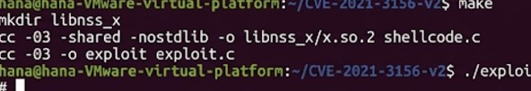
*Figure 4.2 — Compilation de l'exploit avec `make` et obtention du shell root (`#`).*

### Résultat de l'exploitation

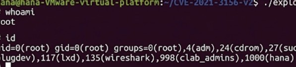
*Figure 4.3 — Shell root obtenu : `whoami` retourne `root`, `id` confirme `uid=0`.*

> ✅ **L'exploit a réussi** — un shell `#` (root) est obtenu **sans mot de passe**. `whoami` retourne `root` et `id` confirme `uid=0(root)`.

### Application du correctif

```bash
sudo apt update && sudo apt install --only-upgrade sudo
```

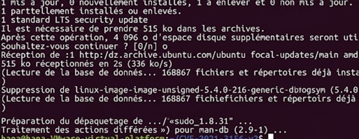
*Figure 4.4 — Installation du correctif `sudo`.*

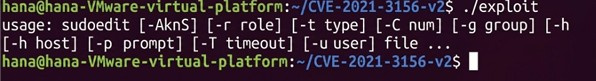
*Figure 4.5 — Après patch : `./exploit` retourne uniquement le message d'usage de `sudoedit`.*

> ✅ **Après la mise à jour de `sudo`, l'exploit échoue** et retourne uniquement le message d'usage de `sudoedit`. L'attaque n'est plus possible.

---

## Étape 2 — Analyse Forensique avec Volatility 3

### Génération du dump mémoire avec LiME

Contrairement au TP prévu sur VirtualBox (`VBoxManage`), l'environnement est **VMware**. L'outil **LiME** (*Linux Memory Extractor*) a été utilisé pour capturer la RAM.

```bash
# Installation des dépendances et compilation de LiME
sudo apt install linux-headers-$(uname -r) build-essential git -y
git clone https://github.com/504ensicsLabs/LiME
cd LiME/src
make

# Génération du dump mémoire
sudo insmod lime-$(uname -r).ko "path=/tmp/memory.lime format=lime"
ls -lh /tmp/memory.lime
```

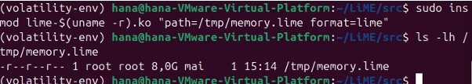
*Figure 4.6 — Dump mémoire généré : fichier `memory.lime` de 8 Go.*

> ✅ Le fichier `/tmp/memory.lime` a été créé avec succès (8,0 Go, = RAM totale de la VM).
> Script : [`scripts/01_lime_dump.sh`](scripts/01_lime_dump.sh)

### Installation et configuration de Volatility 3

```bash
# Environnement virtuel Python
python3 -m venv ~/volatility-env
source ~/volatility-env/bin/activate
pip install volatility3

# Génération du Symbol Table (ISF)
sudo apt install linux-image-$(uname -r)-dbgsym -y
git clone https://github.com/volatilityfoundation/dwarf2json
cd dwarf2json && go build
sudo ./dwarf2json linux --elf /usr/lib/debug/boot/vmlinux-$(uname -r) > ~/linux-$(uname -r).json
cp ~/linux-$(uname -r).json \
   ~/volatility-env/lib/python3.12/site-packages/volatility3/framework/symbols/linux/
```

> Script : [`scripts/02_volatility_setup.sh`](scripts/02_volatility_setup.sh)

> 📌 **Pourquoi un Symbol Table (ISF) ?** Volatility doit connaître la disposition exacte des structures du noyau en mémoire. Ces informations proviennent des **symboles de debug** du noyau (`-dbgsym`), convertis en JSON par `dwarf2json`. Sans ce fichier, l'analyse échoue (voir Figure 4.7).

### Analyse du dump mémoire

#### `linux.pslist` — Liste des processus

```bash
vol -f /tmp/memory.lime linux.pslist
```

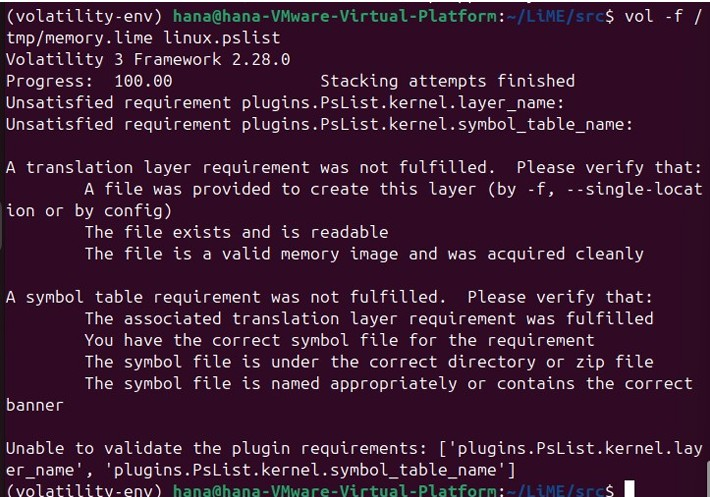
*Figure 4.7 — Première tentative : erreur `symbol table` (avant génération de l'ISF).*

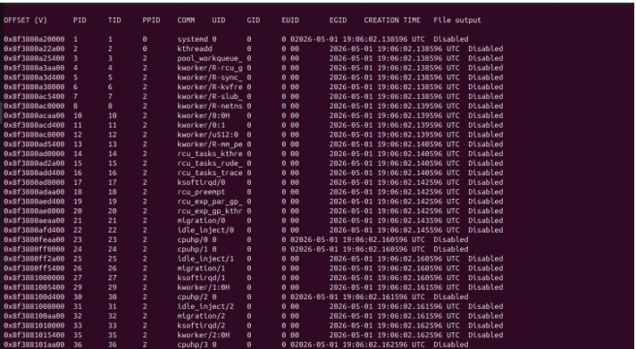
*Figure 4.8 — `linux.pslist` après correction du symbol table — début de la sortie.*

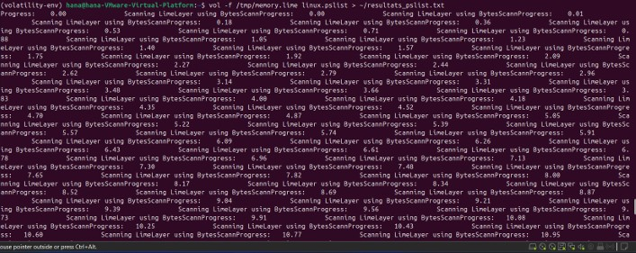
*Figure 4.9 — Sortie complète de `linux.pslist` — liste des processus en mémoire.*

**Processus suspects identifiés**

```bash
vol -f /tmp/memory.lime linux.pslist | grep -E "nc|bash|sh|insmod|sudo"
```

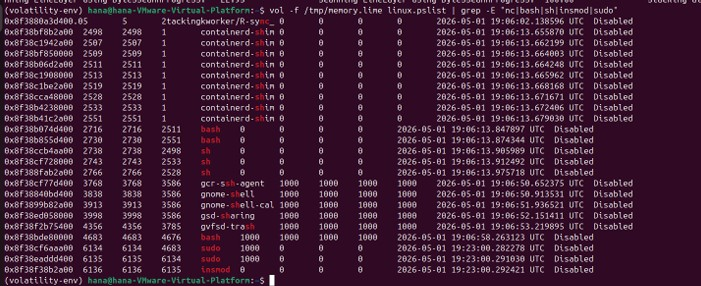
*Figure 4.10 — Processus suspects identifiés : `bash`, `sh`, `sudo`, `insmod` visibles.*

| PID | Processus | PPID | Observation |
|---|---|---|---|
| 2716, 2730 | `bash` | 2511, 2551 | Shell root dans conteneur Docker |
| 2738, 2743, 2766 | `sh` | 2498, 2533, 2528 | Shells root dans conteneurs |
| 4683 | `bash` | 4676 | Terminal utilisateur `hana` |
| 6134, 6135 | `sudo` | 4683, 6134 | Élévation de privilèges |
| 6136 | `insmod` | 6135 | Chargement du module LiME |

#### `linux.pstree` — Arbre des processus

```bash
vol -f /tmp/memory.lime linux.pstree
```

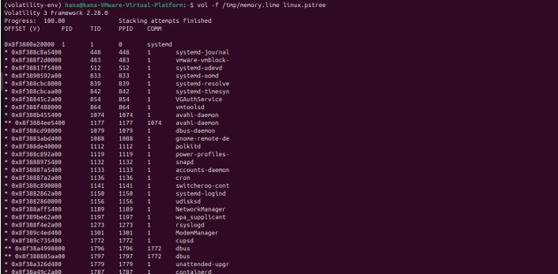
*Figure 4.11 — Arbre des processus : relations parent/enfant clairement visibles.*

L'arbre montre la hiérarchie complète :

- `systemd` (PID 1) est l'ancêtre de tous les services ;
- `avahi-daemon` (PID 1074) a un enfant `avahi-daemon` (PID 1177) ;
- `containerd` (PID 1787) gère les conteneurs Docker actifs ;
- `cupsd` (PID 1772) a deux processus `dbus` enfants.

#### `linux.sockstat` — Connexions réseau

```bash
vol -f /tmp/memory.lime linux.sockstat
```

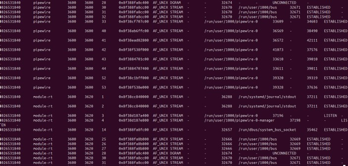
*Figure 4.12 — Connexions réseau : sockets Unix actives (pipewire, dbus, systemd).*

**Services remarquables identifiés**

- `vsftpd` (PID 1788) — Serveur FTP actif, **potentiellement dangereux** (protocole non chiffré) ;
- `nginx` (PID 1845) — Serveur web avec plusieurs workers ;
- `dockerd` (PID 1886) + `containerd` — Environnement Docker actif ;
- `NetworkManager` (PID 1189) — Gestion réseau active.

### Bilan de l'analyse forensique

| Plugin Volatility | Statut | Résultat |
|---|---|---|
| `linux.pslist` | ✅ Succès | Tous les processus listés avec timestamps |
| `linux.pstree` | ✅ Succès | Hiérarchie complète visible |
| `linux.sockstat` | ✅ Succès | Sockets Unix actives analysées |
| `linux.netstat` | ❌ Non dispo | Remplacé par `linux.sockstat` |

---

## Étape 3 — Procédure de Réponse aux Incidents

> Script complet : [`scripts/03_incident_response.sh`](scripts/03_incident_response.sh)

### Simulation de l'attaque par force brute SSH

```bash
sudo systemctl enable ssh && sudo systemctl start ssh

cat > /tmp/passwords.txt << 'EOF'
123456
password
root
admin
toor
hana
azerty
qwerty
ubuntu
123456789
EOF

hydra -l root -P /tmp/passwords.txt ssh://127.0.0.1 -t 4 -v
```

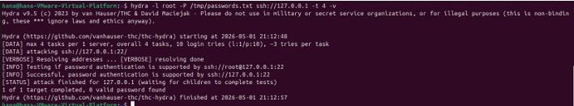
*Figure 4.13 — Attaque Hydra : 10 tentatives sur SSH, aucun mot de passe trouvé.*

> ✅ Hydra v9.5 a testé 10 mots de passe sur SSH. Aucun n'a fonctionné (`0 valid password found`), confirmant que le compte root est correctement protégé.

### Détection de l'attaque dans les logs

```bash
sudo journalctl -u ssh | grep -i "failed\|invalid\|disconnect"
```

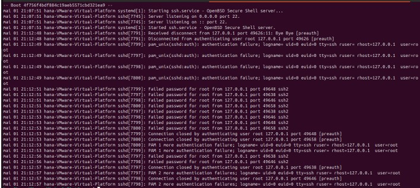
*Figure 4.14 — Logs SSH : traces de l'attaque brute force visibles dans journald.*

Les logs montrent clairement :

- `Failed password for root from 127.0.0.1` — tentatives échouées répétées ;
- `pam_unix(sshd:auth): authentication failure` — PAM bloque les tentatives ;
- `PAM 2 more authentication failures` — compteur d'échecs PAM ;
- `Connection closed by authenticating user root` — connexions rejetées.

### Isolement immédiat du système

```bash
sudo iptables -P INPUT DROP
sudo iptables -P OUTPUT DROP
sudo iptables -L
```

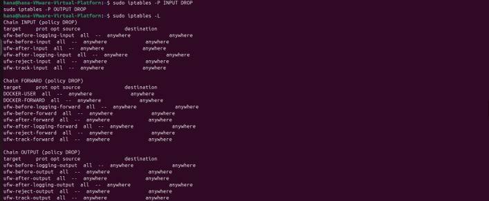
*Figure 4.15 — Règles iptables INPUT et OUTPUT en DROP, système isolé.*

> ✅ **Isolement effectif** :
> - Chain INPUT (policy DROP) — tout trafic entrant bloqué
> - Chain OUTPUT (policy DROP) — tout trafic sortant bloqué
> - Chain FORWARD (policy DROP) — transfert bloqué

### Capture forensique des logs

```bash
sudo tar czf ~/logs-$(date +%Y%m%d).tgz /var/log/
ls -lh ~/logs-*.tgz
```

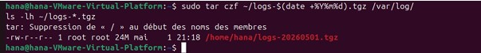
*Figure 4.16 — Archive forensique créée : `logs-20260501.tgz` de 24 Mo.*

> ✅ L'archive `/home/hana/logs-20260501.tgz` (24 Mo) contient tous les logs de `/var/log/`, incluant les traces de l'attaque SSH. Elle constitue la **preuve forensique** de l'incident.

### Chronologie de l'incident

| Heure | Événement | Description |
|---|---|---|
| 21:07:51 | Démarrage SSH | `sshd` écoute sur le port 22 |
| 21:12:48 | Début attaque | Hydra commence l'attaque brute force |
| 21:12:49 | Tentatives | Multiples `Failed password for root` |
| 21:12:53 | Rejet PAM | PAM comptabilise les échecs d'auth |
| 21:12:57 | Fin attaque | Hydra termine — 0 mot de passe trouvé |
| 21:18:00 | Isolement | `iptables` INPUT/OUTPUT DROP appliqué |
| 21:18:00 | Capture | Archive `logs-20260501.tgz` créée |

---

## Bilan et Réflexion

### Récapitulatif des compétences acquises

| Compétence | Outil utilisé | Résultat |
|---|---|---|
| Exploitation CVE | CVE-2021-3156 exploit | Shell root obtenu |
| Application de patch | `apt upgrade sudo` | Exploit corrigé |
| Dump mémoire | LiME + insmod | 8 Go capturés |
| Analyse forensique | Volatility 3 | Processus analysés |
| Symbol table | dwarf2json | JSON 65 Mo généré |
| Détection attaque | journalctl | Logs identifiés |
| Isolement réseau | iptables | DROP appliqué |
| Capture preuves | tar + /var/log | Archive 24 Mo |

### Que faire différemment en production ?

1. **Isolation immédiate et prioritaire** — déconnecter le serveur du réseau de production **avant** toute analyse.
2. **Dump mémoire sur serveur forensique dédié** — transférer le dump via une connexion sécurisée hors-bande.
3. **Notification immédiate** — alerter le RSSI, l'équipe SOC et les parties prenantes dès la détection.
4. **Préservation des preuves légales** — calculer les hash MD5/SHA256 de toutes les preuves, les stocker sur un support **WORM**.
5. **Ne pas redémarrer le système** — un redémarrage détruirait la mémoire volatile et effacerait des preuves cruciales.
6. **Analyse des connexions sortantes** — vérifier si des données ont été exfiltrées.
7. **Patch en urgence** — appliquer immédiatement le correctif `sudo` sur tous les serveurs.
8. **Post-mortem et rapport d'incident** — rédiger un rapport complet (chronologie, impact, mesures correctives).

### Points critiques identifiés sur ce système

- **`vsftpd` actif** (PID 1788) — protocole FTP non chiffré, risque élevé ;
- **Shells root dans Docker** (PID 2716, 2730, 2738) — conteneurs exécutés en tant que root ;
- **SSH sans fail2ban** — aucune limitation de tentatives configurée ;
- **384 paquets non mis à jour** — surface d'attaque importante non corrigée.

---

## Conclusion

Ce TP a permis d'expérimenter concrètement trois dimensions complémentaires de la sécurité des systèmes :

- **Phase offensive** (CVE-2021-3156) — une simple vulnérabilité dans un outil aussi fondamental que `sudo` peut compromettre entièrement un système. L'application du correctif neutralise immédiatement la menace.
- **Phase forensique** (Volatility 3) — la richesse des informations extractibles d'un dump mémoire : processus actifs, connexions réseau, hiérarchie des processus — indispensables pour comprendre un incident.
- **Phase de réponse** (Hydra, journalctl, iptables) — le cycle complet **détection → isolation → capture**. L'adaptation à l'environnement VMware démontre l'importance de comprendre les outils forensiques au-delà des recettes prédéfinies.

---

## Arborescence du dépôt

```
Exploitation-Volatility-3-Reponse-aux-incidents/
├── README.md
├── scripts/
│   ├── 01_lime_dump.sh           # Capture RAM avec LiME
│   ├── 02_volatility_setup.sh    # Installation Volatility 3 + ISF
│   └── 03_incident_response.sh   # Hydra + détection + iptables + capture
└── images/                       # 16 captures d'écran (Figures 4.1 → 4.16)
```

## Références

- [Volatility 3 — Volatility Foundation](https://github.com/volatilityfoundation/volatility3)
- [LiME — Linux Memory Extractor](https://github.com/504ensicsLabs/LiME)
- [dwarf2json](https://github.com/volatilityfoundation/dwarf2json)
- [THC-Hydra](https://github.com/vanhauser-thc/thc-hydra)
- [NVD — CVE-2021-3156](https://nvd.nist.gov/vuln/detail/CVE-2021-3156)

---

*Rapport rédigé par **BOUIKNI Lydia Hana** — Operating Systems Security — 2025/2026*
